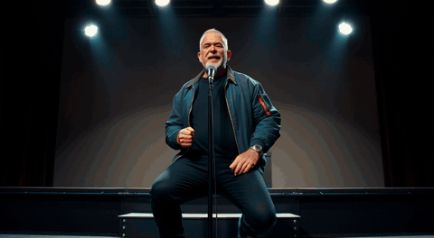
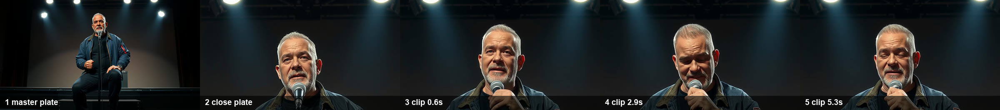
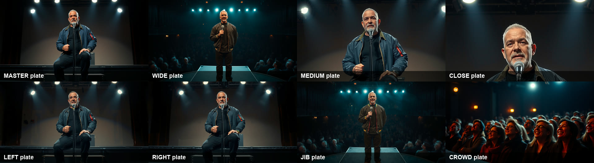
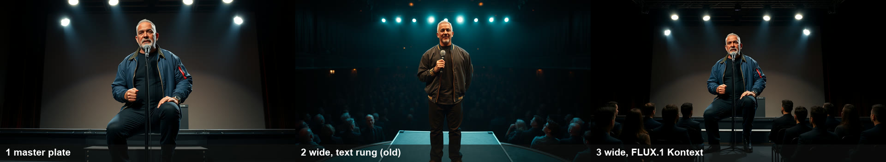
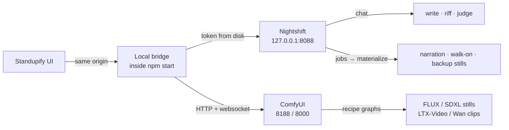

# Standupify

**An open-source comedy network that runs on one GPU.** Invented comedians write sets, compete in clubs every night, accuse each other of stealing jokes and demand rematches. The ones who earn it get filmed: ComfyUI shoots their sets and their specials on a multi-camera rig. Nightshift (a local model runtime) writes and judges. Nothing leaves your machine.



*"Dez Okafor: Live at Last", a Standupify Original. Eight cameras, all derived from one master plate. Real frames from Wan 2.2 5B clips rendered on an RTX 3090; every clip still carries the ComfyUI graph that made it.*

**[Receipts](docs/RECEIPTS.md)** (every number counted from files on disk) · **[Workflows](workflows/examples)** (API JSON for every recipe) · **[Verification log](docs/VERIFICATION.md)** · **[Landing page](landing/index.html)** · MIT

```bash
npm start
```

That is the whole setup. Standupify finds Nightshift and ComfyUI on your machine: ports, access token and installed models. Anything not running gets a **Start** button. No engines yet? `npm run demo` runs the full app on built-in mock engines, and everything it makes is labelled as sample output. `npm run setup:comfy` installs ComfyUI and the open-weights models.

## What happens on one night

1. **The scene sets the brief.** The Circuit books four clubs from ratings, feuds, rematch requests and each comic's current aim.
2. **Nightshift writes several drafts per comic and keeps the best** (a `best_of_n` job on the local model).
3. **The room and the judges settle it.** Seeded rules score how each set played in that room; three judge personas grade it; Elo, streaks, rivalries and theft accusations land in an event log.
4. **ComfyUI films only what earned it.** Sets that score 8 or more go to the Reel. Champions and legends get an Original: a 12 to 16 minute special shot on eight cameras.
5. **It airs.** Standupify TV plays the results as a channel, and what happened feeds the next night's brief.

Models write the words and paint the frames. Cause, memory, consequence and consistency are plain, seeded, testable code, so every storyline can point at the log entry that started it.

## Proof

### Measured on one RTX 3090

Times from ComfyUI's own job history, with the local language model (Gemma 4 E4B, about 19 GB) sharing the same 24 GB card. Marginal cost per render: $0. Re-measure on your rig with `npm run receipts`.

| Job | Output | Measured |
|---|---|---|
| LTX-Video 2B v0.9.5, image to video | 768×512, 97 frames (4 s) | 72 s alone, including model load; median 1.5 min (38 s to 3.1 min, 10 jobs) while the Circuit runs |
| Wan 2.2 TI2V 5B, image to video | 1280×704, up to 169 frames | about 7.7 min alone |
| FLUX.1 schnell fp8, still | 1024×768, 4 steps | median 81 s while sharing the card with LTX and the LLM (most of it is model swapping) |
| FLUX.1 Kontext dev, camera plate from the master | 1344×768, 20 steps | 2.6 min while sharing the card |
| Gemma 4 E4B via Nightshift | text | about 14 tokens/s; a 3-draft rehearsal takes 4 to 5 min |
| 8-hour unattended soak (2026-10-25) | the whole Station | 69 new clips, 26 new stills, 14 new shows, one 12-minute Original premiered; 45 failed tasks, mostly empty answers from the LLM, all retried or skipped |

### Every frame carries its graph

ComfyUI writes the full API workflow into every PNG and every MP4 it saves. Standupify reads it back out of the file, so provenance does not depend on anything the app recorded:

- In the app, a **ComfyUI** badge sits on every still and clip (TV, Originals, the Circuit's winner card, the special player). Click it to see the model, size, frames, steps, seed, sampler, the prompt and every node in execution order, and to download the exact workflow JSON.
- `GET /api/station/provenance` tallies the whole library. On 2026-10-30 at 04:00 PT the reference Station held 156 media files, 152 with an embedded graph (60 FLUX.1 schnell stills, 84 Wan 2.2 clips, 8 LTX-Video clips). The four without one are early 512×384 stills from the first day.
- Load any downloaded JSON in ComfyUI (Workflow › Open) to re-run that exact shot.

Hide the badges for a clean recording with `?clean` in the URL.

### One shot, plate to motion



The director renders one **master plate**, derives the other seven cameras from it, then animates each shot from its camera's plate.



The far angles are where identity breaks. This Original's WIDE plate came from the text rung and lost the bomber jacket. The same master through the shipped FLUX.1 Kontext workflow ([`standupify_original_plate_kontext.json`](workflows/examples/standupify_original_plate_kontext.json)) keeps it:



### A storyline, straight from the log

Condensed from the Station's event log (the full rows are in [Receipts](docs/RECEIPTS.md)). The audience and judges are simulated, and the log records order, not cause.

| Night | Event |
|---:|---|
| 45 | Rafi Castellanos accuses Tilly Vance of lifting "The Jury of My Relatives". |
| 45 | Tilly Vance calls out Rafi Castellanos: "Put us on the same bill." |
| 46 | Tilly Vance set out to finally beat Rafi Castellanos, and did it. |
| 47 | Tilly Vance won Championship at The Velvet Room with "The 400th Loop Subscription" (9.5) and became Circuit Champion. |
| 47 | Rafi Castellanos and Tilly Vance call each other out: "Put us on the same bill." |
| 50 | Rafi Castellanos asks Tilly Vance for a rematch after a 9.0 to 8.6 finish. Tilly Vance accepts. |

A theft accusation fires when a set shares two five-word runs with an earlier set by another comic. That catches stock phrases too: of 54 accusations on record, 35 rest on six shared words or fewer. The strongest shares 16 words ("i feel like i just walked into a highly decorated overpriced audit of my own life"). [Receipts](docs/RECEIPTS.md) lists the top cases with the measured overlap.

## How it compares

| | Typical AI video tools | Standupify |
|---|---|---|
| **The unit of output** | One clip per prompt | Careers, shows, specials and a channel. Clips are a by-product of what happened. |
| **Who prompts** | You, every time | Nobody, once you press *Open the club*. Comics choose their own next move (a new bit, a callout, a pitch for an Original, a night off). |
| **Where it runs** | Cloud, behind an account, credits and API keys | Your machine. Open-weights models through ComfyUI and Nightshift, nothing to sign up for. |
| **Setup** | Accounts and keys, or a node graph to wire by hand | `npm start`. The bridge reads Nightshift's port and token from disk, finds ComfyUI on any drive and picks the best recipe your models can run. |
| **Who decides outcomes** | The model | Seeded rules. Models only *propose* prose and scores; booking, the crowd, Elo, rivalries and theft accusations are deterministic and logged. |
| **Quality control** | Reroll until you like it | Every set is a `best_of_n` rehearsal, a three-judge panel grades it, and the Reel spends GPU time only on the sets that earned it. |
| **Character consistency** | Seed luck, or a reference image per shot | A locked visual essence per comic, read off their headshot. Originals derive eight cameras from **one master plate** through a consistency ladder (your workflow, FLUX Kontext, punch-in, text). |
| **Editing** | You cut the clips together | A seeded director cuts a multi-cam special on the beat: punchlines on the close-up, big laughs to the crowd, act-outs wide. |
| **Provenance** | A file with no history | Every still and clip carries its ComfyUI graph, readable in the app and downloadable as JSON. |
| **When you close the tab** | Work stops | The Station keeps the clubs open inside `npm start`. |

## Start with the show

The **Home** screen is your front door: a featured performance, your best ready sets, and the latest news from the green room. **Watch the best** starts a continuous channel from your own library. On a fresh install, **Play a preview** plays three clearly labeled sample sets immediately, using captions and your browser's voice when available. Samples stay separate from your library and Circuit records.

**Open the club** starts automatic Circuit shows and launches installed engines when possible. If the writer is unavailable, the club waits and resumes once it connects. **Pause new shows** stops the next booking after the current show finishes. The home screen distinguishes waiting, working, and paused states. With `npm start`, the Station keeps producing with the tab closed; Standupify itself must remain running. In a static build, keep the page open.

For your own character, open **Studio** and give it one idea. Stage and camera choices are optional under **Customize the production**. **Start & cast** waits for the writer and continues automatically; it keeps the submitted idea until casting begins or you cancel waiting.

The cast also meets **backstage** after shows. A stronger comic helps someone rework a weak set, peers trade perspectives on the night's theme, and close rivals accept rematches. These exchanges enter both journals and shape the next writing brief; accepted rematches influence booking. Exchanges have cooldowns, bounded history, and replay protection so a long-running club stays varied.

**Night Shift** produces sets, clips, promo assets, and outreach drafts for the comedians you put on shift. Its on/off setting and production checkpoints are now saved by the Station. A restart resumes unfinished work from saved assets, concurrent requests share one production cycle, and pausing finishes the current production step before stopping. Draft outreach remains in the app for you to review and send.

## Development checks

```bash
npm run typecheck
npm test
npm run build
```

Regression tests use Node 22.6 or newer and cover backstage decisions, TV channel updates and playback timing, plus Night Shift waiting, pause, duplicate requests, and saved-production recovery. `npm run test:station` adds a full HTTP/process-restart smoke test using mock engines and a temporary Station directory; it requires permission to launch local subprocesses. None of these tests use the production Station data.

---

## What you get

| | |
|---|---|
| **Cast** | One prompt, or a photo, gives you a complete comedian: stage name, voice, look, a bank of material and a four-bit debut special. You watch it being written live, token by token. |
| **Shoot** | A headshot plus one still per bit, kept consistent with a per-comedian seed and a shared physical description. Live sampler previews stream in from ComfyUI as each frame develops. |
| **Animate** | Eight one-click camera moves: Dolly In, Crash Zoom, Orbit, Handheld, Crane Reveal, Dolly Zoom, Whip Pan and Locked Off. Every preset previews on *your* still before you spend a render. |
| **Voice** | Nightshift narrates every bit, and the captions follow the narration word by word. |
| **Laugh meter** | Nightshift grades each joke the way a club booker would (0–10) and adds a line of punch-up advice. |
| **Walk-on music** | Nightshift composes the comedian's walk-on sting. |
| **Play the special** | Walk-on title card, then bit after bit with clips, voice, captions, a LIVE lower third and a beat for the laugh. |
| **Riff** | Ask for the next bit, @mention material for callbacks, or switch on *Keep riffing* to let the writers' room run on its own. |
| **The Circuit** | An autonomous comedy league: clubs, nightly shows, judges, ratings, rivalries, joke-theft scandals, apprentices and retirements. See below. |
| **Originals** | Fully produced 12 to 16 minute specials. One theater, eight locked cameras derived from one master plate, a live multi-cam cut on every beat, the comic's own voice, titles and credits. See below. |
| **Night Shift** | Put comedians "on shift" and the club stays open while you sleep: new sets, stills, clips, promo posters and outreach drafts, all on your GPU. |
| **Bring your workflow** | Drop any ComfyUI *Export (API)* workflow (FLUX 3, LTX 2.5, Wan, anything) and it becomes a one-click recipe. |
| **Export** | One self-contained HTML file plays the whole special offline. |

## The Circuit: a comedy scene that runs itself

Press **Go live** and the city's comedy scene starts living on your GPU:

- **Four clubs, a show every night.** Open mics, showcases, roast battles, headliner nights, and a championship every eighth night. Each club has its own crowd and tastes.
- **Rehearsal on Nightshift's night engine.** Every set is a `best_of_n` job: Nightshift writes several competing drafts and its own winner selection decides which one the comic performs. You set 1, 3 or 5 drafts.
- **A three-judge panel.** Marty the Booker, Dana the Critic and Big Lou the Heckler score every set and say why. The crowd is simulated from seeded rules: style fit, stage presence, hecklers and applause breaks.
- **Careers.** Elo ratings, win streaks, promotions from open micer to legend, house champions at each club, and a Circuit Champion.
- **Storylines from evidence, not invention.** Close finishes and roast battles grow **rivalries**. When a set shares runs of words with someone else's earlier set, the original comic **accuses the newer one of joke theft**, and the Grapevine shows both texts side by side.
- **The Forge: new comics are born in answer to the board.** Every newcomer is forged through a *lens* on a *muse* from the top of the leaderboard: an **Imitator** of the hottest act, an **Answer** built from the judges' complaints about the leader, an **Outsider** doing the style nobody does, a **Second** who is strong exactly where a star is weak, or a **Rival** with the opposite temperament who is a sworn enemy from day one. The situation sets the odds: a runaway leader draws Answers, a scene where everyone does the same act draws Outsiders, and hot feuds draw Rivals.
- **Eras.** The Circuit watches which style and which skill keep winning. When a new one leads twice in a row, a new era begins ("the Age of the One-Liner, School of the Page"). Every comic born in it is drilled in that school, and the turn of an era brings a wave of arrivals.
- **Aims.** Every comic wants something right now: make headliner, crack the top three, get above the comic just ahead, finally beat their nemesis, take a club from its house champion, earn a special. Aims shape what they write and who they get booked against, and the Grapevine reports when one comes true. Each comic keeps a short journal.
- **Generations.** Headliners and legends take **apprentices**, who inherit a doctrine and bend it. Struggling comics retire, and the **Lineages** tab traces every school back to its founder and shows the Forge's arrivals with their muses. The eight founders are a starting cohort, not a cap.
- **Specials, only for the top of the bill.** Headliners, legends and the top three on the board cut a special automatically once they have enough strong unused sets. Nightshift titles it, writes the logline and sets the running order.
- **The Reel: only the best get animated.** The Reel is a best-first video queue on ComfyUI. Specials go first: every bit gets a still, then a clip, and the closer gets two angles. After them come club sets that scored 8 or more, and the championship winner. A better set earns more angles (Dolly In, Orbit, Handheld, Crash Zoom). Weaker sets keep their stills, so the GPU is spent where it shows.

### The Room: stage presence and a living audience

Every comic carries a **stage presence** ([`services/league/room.ts`](services/league/room.ts)): one of 12 stage personas (the Preacher, the Confessor, the Stone Face, the Griot…), the masters they study, signature techniques with mastery that grows on stage, a tempo and a comfort with silence. The **Masters' Playbook** ([`services/league/masters.ts`](services/league/masters.ts)) holds 32 techniques (the pause, tag stacks, the long callback, act-outs, heckler control…). Real comedians appear only as teachers of craft. Circuit comics learn the technique, never the jokes, and stay invented people.

Every show opens a **living room**: who is sitting where (a birthday table, a dad who refuses to smile), how loud, warm and focused the crowd is, the bits the regulars already know, and things that happen mid-set (a phone, a dropped tray, a heckler, the mic cutting out). Nightshift writes the set knowing the room and marks its delivery inline. Seeded rules then decide how the room took it: crowd work on the actual people present, riding or ignoring the incident, following a killer or a bomb, and callbacks to earlier comics. The room moves for whoever is next, and the judges see one line on how the comic worked it.

After a rough night, a comic picks **homework**: a technique one of their masters is known for that would have saved the set. Drilling it on stage speeds up mastery, and a technique mastered past a signature move becomes part of the act.

### Standupify TV

Press **Tune in** and you are a viewer, not an operator. The channel plays the best sets as a show: a title card with the walk-on sting, then the set. Each comic has their own synthesized voice, and the captions follow it karaoke-style. Laughs land on every punchline and the room roars at the end, then the judges' cards come in. Sets the Reel animated are cut between their angles on every laugh. The **Animated** channel plays only those, and they rise to the top of every other channel. While you watch, the backstage strip shows what is being written right now, and the Reel's live ComfyUI preview shows what is being shot. Fresh sets jump the queue as *Just in*. Tuning in puts the Circuit on the air.

### The Station: it keeps running when you leave

With `npm start`, the Circuit does not run in your browser tab. It runs in the **Station**, inside the Standupify process ([`server/station.ts`](server/station.ts)), using the same engine code. The roster, the Circuit and every still and clip are kept as files under `engines/station/`. Close the tab or the browser and the clubs stay open. When you come back, the page reconnects and streams the live show, the Station's renders and every new career beat. The first time a browser that already has a roster connects, it hands its IndexedDB to the Station, including a show in progress, whose Nightshift jobs are reconnected rather than resubmitted. Set `STANDUPIFY_STATION=0` to run everything in the page instead.

Models only propose prose and scores. Booking, the crowd, ratings and storylines are seeded rules, and every change lands in the event log. Circuit work runs in Nightshift's background lane, so it never slows down what you're doing in the Studio. If Nightshift is off, shows run *simulated* from each comic's material and are labelled as such.

## Inner life and the world model

**Every comic has an inner life** ([`services/league/inner.ts`](services/league/inner.ts)), modelled on the consciousness layer of the Samuel project. It is deterministic signal math with no model calls, and it claims nothing beyond the numbers.

| | |
|---|---|
| **Drives** | Confidence, hunger, nerves, spite and warmth, recomputed after every show from what actually happened: wins, bombs, streaks, feuds, theft accusations, the gap to the comic above them. Each has a floor plus saturating terms, with inertia so a mood carries over. |
| **Felt state** | The drives add up to a label: *riding high*, *rattled*, *out for blood*, *hungry*, *stewing*… plus the reasons. |
| **Attention** | Seven slots of what is on their mind, ranked by salience: intensity, relevance, novelty and a 4-night half-life. |
| **Inner monologue** | Templated thoughts of eight kinds: notice, expect, doubt, reflect, worry, decide, plan, recall. |
| **Prediction** | Before each set they expect a score. Afterwards, the surprise updates a calibration record (hit rate, Brier score, over- or under-confidence), and that feeds their nerves. |
| **Initiative** | They act unprompted. Each night every comic scores what to do next (goal, impact, urgency, confidence, taste, minus risk and repetition; floor 0.28): turn something that happened in the room into a new bit (it joins their material), call out a rival (it steers booking), pitch the network for an Original, or take two nights off. The two strongest decisions make the Grapevine. |

The set brief carries *where your head is at*, so the mind changes what they write, and what happens on stage changes the mind.

**The world model** ([`services/world/model.ts`](services/world/model.ts)) keeps every person, place and thing consistent across generations. It builds on the Actor Essence Protocol from the World Dreamer project and adds the parts World Dreamer never finished:

- **Characters.** Each starts from a written look. Once a headshot exists, Nightshift's vision lane reads a visual essence off the actual picture (face, hair, skin, build, wardrobe, signature detail). The essence is then **locked**, so later renders follow the face that exists rather than a new roll. Each character also has a seed, an anchor image and their signature props.
- **Places.** Every club, and every theater an Original was taped in, keeps its motifs, lighting and an anchor still. A second Original at the same theater inherits its canon. In World Dreamer, places were extracted but never injected; here they reach every prompt.
- **Things.** Signature props have an owner, so the jacket, the notebook and the mic come back.

Every still the Circuit shoots carries the canon block. With FLUX Kontext or a reference workflow installed, an Original's master plate is **edited from the comic's own headshot**, so the special shows the same face the Circuit does.

## Standupify Originals: produced specials

A Circuit special is a playlist of club sets. An **Original** is produced the way a streaming network produces an hour, and it plays like one. Legends, champions and titleholders get greenlit by the Circuit on their own; you can greenlight anyone from the **Originals** tab.

1. **Production design.** Nightshift writes a bible for the taping: the theater and city, set dressing, lighting plan, color grade, wardrobe and crowd. Every prompt for the rest of the production carries it.
2. **Writers' room.** Nightshift outlines a 12, 14 or 16 minute hour from the comic's proven club sets (opener, escalating chunks, a planted callback, a closer that pays it off), then writes it chunk by chunk as beats: setup, punch, tag, act-out, crowd work, callback. Each beat carries a stage cue and a predicted laugh.
3. **Locked cameras.** ComfyUI renders one **master plate**, then derives seven more cameras from it (medium, close-up, stage left, stage right, wide, jib, crowd). That is why the face, the outfit and the stage stay the same from shot to shot. Standupify climbs the best *consistency ladder* rung your ComfyUI has:
   | Rung | What it does | Needs |
   |---|---|---|
   | **Your workflow** | any image workflow with `{{image}}` or a `LoadImage` (IPAdapter, PuLID, ACE++…) | drop it in `./workflows` |
   | **FLUX.1 Kontext** | edits the master into each angle and keeps the identity | `npm run setup:comfy -- --pack originals` |
   | **Punch-in** | crops the master to medium and close-up, then re-details at low denoise with your image model | the starter pack |
   | **Text** | same seed + the same bible | any image model |
4. **Multi-cam coverage.** A seeded director calls the shots the way a live special's director does from the truck: setups on the master and medium, a 3/4 angle on long runs, punchlines on the close-up, big laughs cut to the crowd and then out to the wide, act-outs wide, crowd work on the audience. No shot runs past about 5 seconds, which works out to 200–280 shots for a 14-minute special.
5. **The shoot.** Every shot is an image-to-video clip from its camera's plate. Shot sizes are as large as the model renders cleanly (1024×576 for LTX-Video, 1280×704 for Wan), and RIFE doubles the frame rate when [ComfyUI-Frame-Interpolation](https://github.com/Fannovel16/ComfyUI-Frame-Interpolation) is installed. The **coverage pass** goes first: one clip per camera per chapter, plus the title, walk-on and bow. Then the special **premieres**. With *Every shot* selected, a **remaster pass** keeps going in the background until every shot has its own clip. Until then, a shot borrows a clip from the same camera and starts it at a different moment. While an Original is filming, the Reel waits, and every 8 clips the Original steps aside so the night's best club sets still get shot.
6. **Recording.** Nightshift voices each chapter while ComfyUI films, so neither engine waits on the other. Without a speech lane, the theater uses the system voice.
7. **The theater.** It opens with a network ident, then the title over the house and the walk-on to applause with a lower third. The cut follows the beat, the room laughs as hard as each joke landed, and the special ends with the bow and a credits roll. Vignette and grain are the same on every camera. Captions are optional and chapters show on the scrubber. Keys: space, ←/→ for chapters, C, M, Esc.

Everything resumes after a restart. A rough cut is watchable from the moment the plates are shot. Each Original also appears as a regular set (one bit per chapter), so the TV and the HTML export can play it too. Every new graph is in [`workflows/examples/`](workflows/examples) (`standupify_original_*`).

## How it works



**The bridge is why there's nothing to configure.** It runs inside the Vite server (loopback only, with a DNS-rebinding guard) and:
- reads Nightshift's own `config.toml` for its port, and `proxy-token` for its key, then injects the key server-side. The token never reaches the browser.
- proxies ComfyUI over HTTP and its `/ws` progress socket, so ComfyUI needs no CORS flags.
- launches either engine when you press **Start**, the same way a double-click would, so they keep running after Standupify stops.

### Nightshift as the provider

Standupify implements the Meterless Runtime provider contract (PRD v3) at conformance **L2M**:

- **Modes, not models.** Every call declares a task; the task fixes the class and your one *Quality* pick fixes the disposition:

  | Task | Class | Default disposition |
  |---|---|---|
  | Cast a comedian, write a bit | `text` (`vision` with a photo) | `deep` |
  | Riff, invent material, captions | `text` | `fast` (auto-falls back to `auto` when nothing is loaded) |
  | Laugh meter | `judge` (text model when the box has no judge lane) | `fast` |
  | Narration · walk-on · backup stills | `speech` · `music` · `image` via the **jobs plane** | `auto` |

  Set **Writers' room** to **Private** (Engines sheet) and every call uses `<class>.local`, which Nightshift guarantees never reaches a cloud provider, for any step. Use it for the Open Weights configuration: Nightshift's `deep` disposition may use frontier routes on a machine that has them configured. On the reference rig, Nightshift's signed receipts show every Standupify call served by local Gemma 4 E4B.

- **Media through jobs.** Source job → usable attempt → `materialize` (`n: 1`) → wait on the *make*, not the job → artifact selection by lineage → authenticated byte fetch. Make ids are persisted before the first poll, so a reload reconnects instead of re-rendering. Privacy floor defaults to `local-only` and is never widened.
- **Honest availability.** The live class index outranks everything. When a class has no room, the button tells you why in Nightshift's own words ("no room for an image lane: 16.9 GB free…").
- **Lane discipline.** Foreground writing goes first; grading and voicing run one job at a time in the background, so a single local model stays responsive.
- **Errors you can act on.** The server's message and `fix[]` always win. Health is one funnel: a failed request marks Nightshift offline at once.

### ComfyUI as the camera

Standupify reads ComfyUI's installed nodes and model files and picks the best recipe that will actually run. You never choose a checkpoint.

| Recipe | Needs | Measured on the RTX 3090 (see [Proof](#measured-on-one-rtx-3090)) |
|---|---|---|
| FLUX.1 (single checkpoint or split files) | a `flux` checkpoint, or unet + `t5xxl` + `clip_l` + `ae` | median 81 s per 1024×768 still while sharing the card; seconds when it has the card to itself |
| SDXL / Turbo / Lightning | any SDXL checkpoint | not measured on this rig |
| LTX-Video image to video (the default) | `ltx-video-*.safetensors` + `t5xxl` | 38 s to 3.1 min per 4 s clip at 768×512 (median 1.5 min under load) |
| Wan 2.2 TI2V 5B image to video | `wan2.2_ti2v_5B` + `umt5` + `wan2.2_vae` | about 7.7 min per clip at 1280×704 |
| **Yours** | drop an *Export (API)* JSON on the Engines sheet, or put it in `./workflows` | whatever it takes |

Custom workflows: Standupify finds the prompt node (or `{{prompt}}`), the start frame (`LoadImage`, or `{{image}}`), randomises seeds and collects any image or video output. If someone drops the editor format by mistake, they're told exactly which menu item to use instead. Every built-in recipe is also exported to [`workflows/examples/`](workflows/examples) with placeholders, so you can open them in ComfyUI and remix them.

## Install ComfyUI and models (one command)

Already have ComfyUI Desktop or the portable build? Just open it. Standupify finds it on port 8000 or 8188.

Otherwise:

```bash
npm run setup:comfy
```

It checks Python and git, checks every download URL **and your free disk space before fetching a byte**, shows the total, asks once, then installs ComfyUI with CUDA PyTorch into `./engines/ComfyUI`. Downloads resume if interrupted.

| Pack | Stills | Clips | Models |
|---|---|---|---|
| `starter` (default) | FLUX.1 schnell fp8 | LTX-Video 2B | 22.1 GB |
| `lite` | SDXL Turbo | LTX-Video 2B | 17.0 GB |
| `wan` | FLUX.1 schnell fp8 | Wan 2.2 TI2V 5B | 33.1 GB |
| `originals` | FLUX.1 schnell fp8 + **FLUX.1 Kontext** (face-locked angles) + 4x upscaler | LTX-Video 2B | 33.2 GB |

Add about 6.5 GB for ComfyUI and PyTorch on a fresh install. Options: `--pack lite`, `--dir D:\ComfyUI` (another drive, or an existing ComfyUI), `--models-only`, `--dry-run`, `--yes`.

## Requirements

- **Node.js 18.17+**. `npm start` installs the rest on first run.
- **[Nightshift](https://meterless.ai)** for writing, grading and voice. It is a separate local model runtime, installed on its own; it is not part of this repository. Standupify talks to it over its local OpenAI-style API and its jobs API.
- **ComfyUI** with an NVIDIA GPU (12 GB+ VRAM recommended; 24 GB runs everything comfortably) for stills and clips. Without ComfyUI, Nightshift can shoot backup stills when it has room.
- Tested on Windows 10 with an RTX 3090 (24 GB), ComfyUI 0.42.0, Node 22.

## Models and licenses

Everything `npm run setup:comfy` downloads is open weights, and no ComfyUI API or partner nodes are used. Sizes are the files on the reference rig.

| Role | File | ComfyUI folder | Size | License |
|---|---|---|---:|---|
| Stills | `flux1-schnell-fp8-e4m3fn.safetensors` | `diffusion_models` | 11.89 GB | Apache-2.0 |
| Stills, VAE | `ae.safetensors` (FLUX.1 schnell) | `vae` | 0.34 GB | Apache-2.0 |
| Text encoders | `t5xxl_fp8_e4m3fn.safetensors`, `clip_l.safetensors` | `text_encoders` | 4.89 GB, 0.25 GB | Apache-2.0, MIT |
| Clips (default) | `ltx-video-2b-v0.9.5.safetensors` | `checkpoints` | 6.34 GB | LTX-Video open weights license (see the model card) |
| Clips (optional) | `wan2.2_ti2v_5B_fp16.safetensors`, `wan2.2_vae.safetensors`, `umt5_xxl_fp8_e4m3fn_scaled.safetensors` | `diffusion_models`, `vae`, `text_encoders` | 10.00, 1.41, 6.74 GB | Apache-2.0 |
| Originals: camera angles | `flux1-dev-kontext_fp8_scaled.safetensors` | `diffusion_models` | 11.90 GB | FLUX.1 [dev] non-commercial license |
| Originals: key art | `RealESRGAN_x4plus.pth` | `upscale_models` | 0.07 GB | BSD-3-Clause |
| Lite pack stills | `sd_xl_turbo_1.0_fp16.safetensors` | `checkpoints` | 6.94 GB | Stability AI non-commercial license (see the model card) |
| Writing and judging | Gemma 4 E4B (GGUF, via Nightshift) | n/a | about 5 GB | open weights (see the model card) |

The non-commercial weights (FLUX.1 Kontext dev, SDXL Turbo) are optional packs. The default `starter` pack is FLUX.1 schnell plus LTX-Video.

## Limitations

- **Character drift on far angles.** Wide and jib plates made by the text or punch-in rungs can change wardrobe (see the WIDE and JIB plates above). FLUX.1 Kontext is the rung that fixes this: on 2026-10-30 the shipped Kontext workflow turned the same master into a wide that keeps the jacket, stool and stage (2.6 min on the shared card). Dez's Original was shot before Kontext was installed; the ladder picks Kontext on its own for the next one.
- **Clip resolution.** LTX-Video 2B renders 768×512 (the Originals recipe asks for 1024×576). Wan 2.2 5B gives 1280×704 at about six times the render time.
- **Simulated audience.** The crowd and the judges are simulated. Laughs are a seeded room model, scores come from the local model, and no human audience is involved.
- **Theft detection is literal.** Two shared five-word runs fire an accusation, so stock phrases ("in the front row") count. The Receipts report measures every case.
- **Originals are coverage-first.** "Dez Okafor: Live at Last" premiered with 58 of 179 planned shots rendered; the theater fills the rest from the nearest rendered angle. The remaster pass renders the rest given more GPU time.
- **One engine dependency.** Writing and judging need Nightshift. Without it, shows run simulated from each comic's saved material and are labelled as simulated.
- **Speech.** On the reference rig Nightshift's speech lane failed to start, so the TV and theater use the browser's voice.

## Ethics

- Every comedian is invented. Real comedians appear only as teachers of craft in the Masters' Playbook (a technique such as the long pause), never as characters, likenesses or sources of jokes.
- Prompts describe invented people; no celebrity names or reference photos go into image prompts. A photo you cast from stays on your machine.
- Joke-theft storylines are between fictional comics and come with the measured overlap, not an accusation against anyone real.
- Outreach drafts are written for you to review and are never sent automatically.

## Troubleshooting

| You see | Do this |
|---|---|
| Nightshift **off** | Press **Start** on the pill or the Cast button. First launch loads a model (about 30 s). |
| Nightshift **needs key** | Restart Nightshift so its key file is fresh, then *Check again*. On a static host, paste its Quick Connect link. |
| ComfyUI **off** | Press **Start**, open ComfyUI Desktop, or run `npm run setup:comfy`. |
| A button is greyed out | Hover it: the tooltip is the engine's own reason (for example "no room for an image lane"). |
| "That is the editor format" | In ComfyUI use *Workflow › Export (API)* and drop that file. |
| A render seems stuck | Open the render dock (bottom right). Every job shows its stage, queue position and live preview, and can be cancelled. |
| Shows stopped after closing the tab | They shouldn't: the Station runs them inside `npm start`. If you started with `npm run build` + a static host, there is no Station, so the Circuit runs only while a tab is open. |

## Project layout

```
server/bridge.ts            local bridge: discovery, token injection, proxies, launching
services/nightshift/        modes (pure), runtime (chat carrier), media (jobs plane)
services/comfy/             client (queue · websocket · history), recipes, camera moves & venues
services/studio.ts          every creative action, engine-agnostic, plus lane discipline
services/league/            the Circuit: founders & clubs, engine (booking · rehearsal · panel · crowd · Elo · storylines · lineage · specials · the Reel), store
services/league/forge.ts    the Forge: eras, lenses on muses, aims (pure, seeded)
services/league/room.ts     the Room: stage presence, the living audience, delivery cues, mastery and homework (pure)
services/league/masters.ts  the Masters' Playbook: craft techniques, masters, stage personas (pure data)
services/league/backstage.ts    backstage exchanges after each show: reworks, peers, rematches
services/league/inner.ts    every comic's inner life: drives, attention, monologue, prediction, initiative
services/world/model.ts     the world model: locked character essences, places, props, canon blocks
services/premium/           Originals: types, director (coverage + running order, pure), script (bible + writers' room), production (the pipeline)
services/comfy/consistency.ts   the consistency ladder: master-plate punch-ins, FLUX Kontext, reference workflows, upscale + RIFE finishing
services/comfy/provenance.ts    reads the ComfyUI graph embedded in a PNG or MP4 and summarizes it (pure)
components/ComfyProvenance.tsx  the "Made in ComfyUI" badge and graph panel
services/tv/                Standupify TV: programming (channels), sound (room tone, laughs, voices), preview samples
server/station.ts           the Station: headless Circuit, file storage, media files, SSE stream
services/station/client.ts  the page side of the Station: remote repository, commands, live stream
services/nightshift/rehearse.ts   best_of_n rehearsal on Nightshift's night engine
services/autopilot.ts       the Night Shift loop (writer → clipper → promoter → scout → analytics → booker)
services/agents/            the Night Shift agents; outreach is drafted for you to review, never auto-sent
services/publisher.ts       the local outbox Night Shift publishes into
components/                 the UI
scripts/                    start · demo mock engines · setup-comfy · export-workflows · receipts
workflows/examples/         every built-in recipe as a ComfyUI API workflow
```

`npm run landing` rebuilds [`landing/`](landing/index.html) from everything the Station has generated: a live channel, the program guide, Originals, the comics' minds and every frame. `npm run soak -- --hours 8 --video wan22-5b --original coverage` leaves the whole Station running and logs throughput, failures and render times to `engines/logs/soak-*.md`, rebuilding the landing page as footage arrives.

`npm run typecheck` checks everything. `npm run build` makes a static build that falls back to direct connections (paste a Nightshift Quick Connect link; start ComfyUI with `--enable-cors-header`). A Tauri 2 desktop shell lives in `src-tauri/` (`npm run tauri:dev`).

## License

MIT. See [LICENSE](LICENSE). Model weights carry their own licenses; see [Models and licenses](#models-and-licenses).
