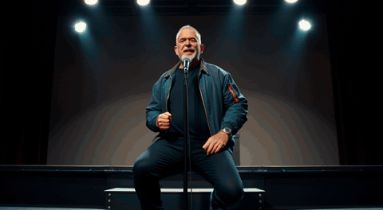
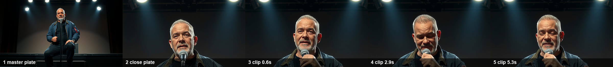
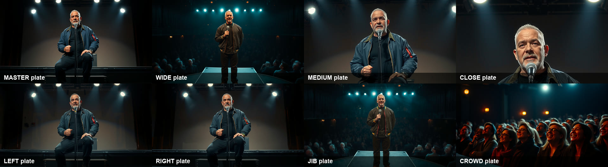
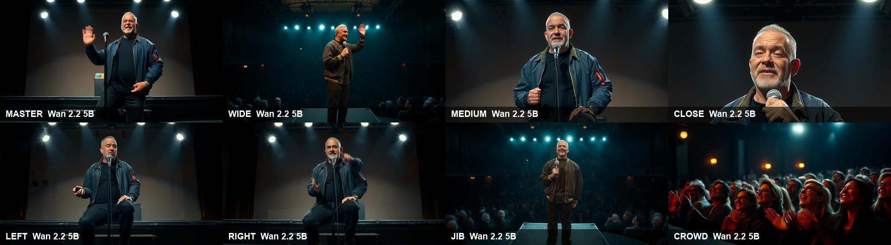
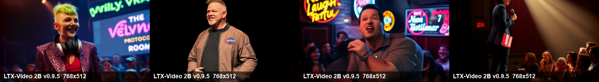

# Receipts

Generated by `npm run receipts` on 2026-10-30 11:17 UTC from the Station data on this machine. Every number below is counted from files on disk. Re-run the command to check it.

**What is simulated:** the audience and the judges. Crowd reactions come from a seeded room model; judge scores come from the local language model. No human audience was involved. Outcomes (wins, ratings, accusations) are decided by seeded rules over the logged sets.

## The Station at a glance

| | |
|---|---|
| Nights on the Circuit | 50 |
| Comedians | 17 |
| Shows on record | 50 |
| Sets and bits | 44 |
| Logged events (latest 400) | applause 86, mind 77, theft 54, room 40, study 40, win 36, aim 17, special 17, promotion 8, title 5, upset 5, rivalry 4, era 2, debut 2, arrival 2, streak 2, apprentice 2, bomb 1 |
| Current champion | Tilly Vance |
| Media files | 159, of which 155 carry their ComfyUI graph |

## Every frame carries its graph

ComfyUI writes the full API-format workflow into each PNG and each SaveVideo MP4. This table is read from those embedded graphs, not from Standupify's own records. In the app, the **ComfyUI** badge on any still or clip opens the same graph and downloads it as JSON.

| Model | Kind | Files | Resolution | Frames | Steps |
|---|---|---:|---|---|---|
| Wan 2.2 5B | video | 84 | 1280×704, 960×544 | 137, 129, 93, 85, 109, 101, 169, 133, 65, 125, 97, 69, 61, 145, 117, 121, 141, 113, 149, 81 | 20 |
| FLUX.1 schnell | still | 60 | 1024×768, 832×1024, 1344×768, 456×264, 832×480 | - | 4, 7, 10, 9 |
| LTX-Video 2B v0.9.5 | video | 11 | 768×512 | 97 | 30 |

## Measured render times

From ComfyUI's own job history (execution start to finish, queue wait excluded) on **NVIDIA GeForce RTX 3090**, ComfyUI 0.42.0. The local language model shares the same card, so these are times under load. Marginal cost per render: $0.

| Model | Kind | Resolution | Frames | Jobs | Median | Fastest | Slowest |
|---|---|---|---|---:|---:|---:|---:|
| LTX-Video 2B v0.9.5 | video | 768×512 | 97 | 10 | 1.5 min | 38.2 s | 3.1 min |
| FLUX.1 schnell | still | 1024×768 | - | 5 | 80.8 s | 61.9 s | 3.0 min |
| FLUX.1 Kontext dev | still | 1344×768 | - | 1 | 2.6 min | 2.6 min | 2.6 min |

## Contact sheets

Frames pulled straight from the files with ffmpeg. No retouching, no cherry-picked takes beyond "first rendered shot per camera".

**One shot, plate to motion.** The master plate, the camera plate derived from it, then three frames of the image-to-video clip.

**Eight camera plates for one Original.** Each angle is derived from the master so the comedian, room and wardrobe stay put.

**Coverage.** A frame from the first rendered clip on each camera.

**Circuit highlights on LTX-Video.** The newest stage clips the Station rendered with the LTX recipe.

## Originals

| Title | Comedian | Stage | Planned shots | Shots with a rendered clip | Cameras covered | Plates | Planned runtime | Clip models |
|---|---|---|---:|---:|---:|---:|---:|---|
| Dez Okafor: Live at Last | Dez Okafor | premiered | 179 | 58 | 8 | 8 | 11.5 min | Wan 2.2 5B 58 |
| 400 Loops of Despair | Tilly Vance | script | 0 | 0 | 0 | 0 | 0.0 min | - |

Originals are shot coverage-first: every beat gets a planned shot, the director renders the shots that matter most first, and the theater fills unrendered shots from the nearest rendered angle or its camera plate. A premiered Original is watchable end to end; it does not mean every planned shot is a unique render.

## Joke theft, measured

An accusation fires when a set shares at least two five-word runs with an earlier set by another comic (`findTheft` in `services/league/engine.ts`). It is evidence, not proof. Below, the longest run of words the two sets actually share, measured here from the stored texts.

54 accusations on record. 35 rest on a shared run of six words or fewer (stock phrases such as "in the front row"); the strongest cases:

| Night | Accuser | Accused | Bit | Longest shared run |
|---:|---|---|---|---|
| 18 | Tilly Vance | Dez Okafor | 400th Failure | 16 words: "i feel like i just walked into a highly decorated overpriced audit of my own life" |
| 45 | Marjorie Pell | Rafi Castellanos | The Judgment of the Gums | 10 words: "the one who always laughs one second after everyone else" |
| 35 | Kenji Nakamura | Elias Finch | Automated Existential Dread | 8 words: "so we're here at rooftop riot bathed in" |
| 33 | Juniper Quill | Marjorie Pell | The Billable Breakfast | 8 words: "gentleman in the front row the one who" |
| 30 | Tilly Vance | Bree Okoro | Monstera Meltdown | 8 words: "in the front row you look like you" |

## One rivalry, as logged: Rafi Castellanos and Tilly Vance

The most frequent pairing in the theft, callout and rivalry events, with each comic's wins and titles in between. The log records order, not cause.

| Night | Event |
|---:|---|
| 45 | Rafi Castellanos won Showcase at Neon Laugh Factory with “The Ficus Tribunal” (8.9). |
| 45 | Rafi Castellanos accuses Tilly Vance of lifting “The Jury of My Relatives”. The evidence: “…in the front row who…” |
| 45 | Tilly Vance calls out Rafi Castellanos: “Put us on the same bill.” |
| 46 | Tilly Vance set out to finally beat Rafi Castellanos, and did it. |
| 47 | Tilly Vance is the Circuit Champion. |
| 47 | Tilly Vance won Championship at The Velvet Room with “The 400th Loop Subscription” (9.5). |
| 47 | Tilly Vance calls out Rafi Castellanos: “Put us on the same bill.” |
| 47 | Rafi Castellanos calls out Tilly Vance: “Put us on the same bill.” |
| 48 | Tilly Vance set out to finally beat Rafi Castellanos, and did it. |
| 49 | Tilly Vance won Roast Battle at Neon Laugh Factory with “The Neon Tribunal (Revisited)” (9.0). |
| 49 | Tilly Vance calls out Rafi Castellanos: “Put us on the same bill.” |
| 49 | Rafi Castellanos calls out Tilly Vance: “Put us on the same bill.” |
| 50 | Rafi Castellanos asks Tilly Vance for a rematch after a 9.0, 8.6 on night 50 finish. Tilly Vance accepts. |
| 50 | Tilly Vance set out to finally beat Rafi Castellanos, and did it. |

## Workflows in this repo

API-format graphs in `workflows/examples/`. "Rendered here" counts Station files whose embedded graph has exactly the same set of nodes.

| Workflow | Model | Nodes | Resolution | Rendered here |
|---|---|---:|---|---:|
| `standupify_clip_ltxv.json` | LTX-Video 2B v0.9.5 | 15 | 768×512 | 11 |
| `standupify_clip_wan22-5b.json` | Wan 2.2 5B | 12 | 960×544 | 84 |
| `standupify_original_plate_kontext.json` | FLUX.1 Kontext dev | 14 | 1344×768 | 0 |
| `standupify_original_plate_punch-in.json` | FLUX.1 schnell | 12 | 456×264 | 2 |
| `standupify_original_shot_ltxv-rife.json` | LTX-Video 2B v0.9.5 | 16 | 1024×576 | 0 |
| `standupify_still_flux-ckpt.json` | FLUX.1 schnell | 7 | 1024×768 | 0 |
| `standupify_still_flux-split.json` | FLUX.1 schnell | 9 | 1024×768 | 54 |
| `standupify_still_sdxl.json` | SDXL Turbo | 7 | 1024×768 | 0 |
